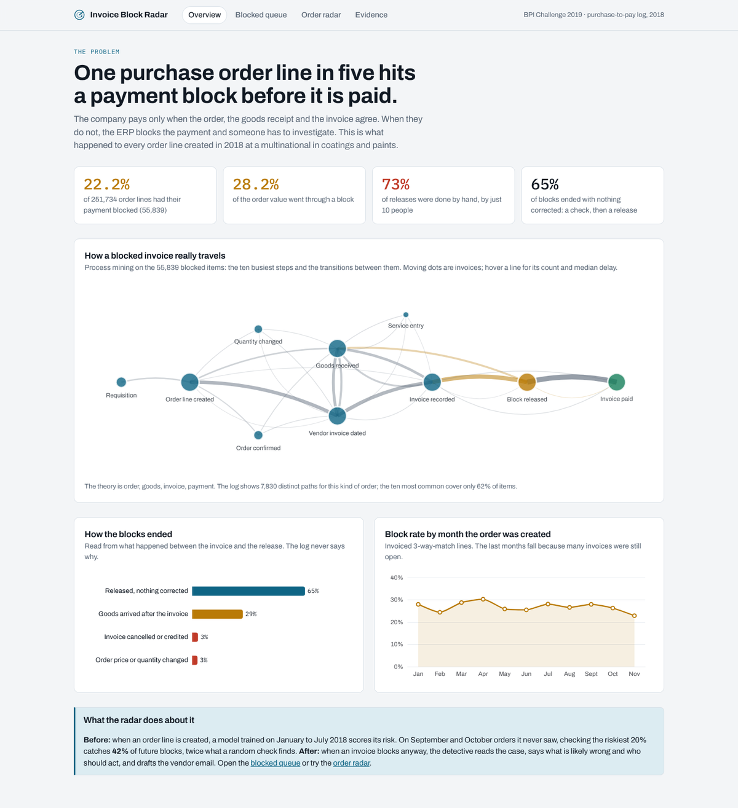
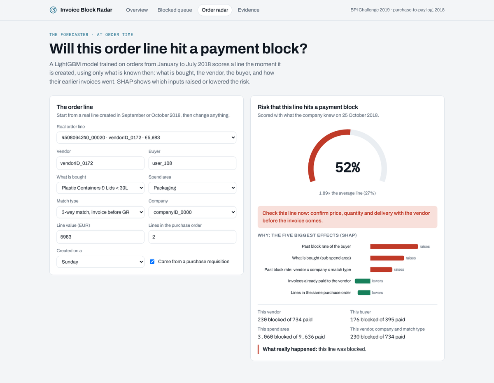
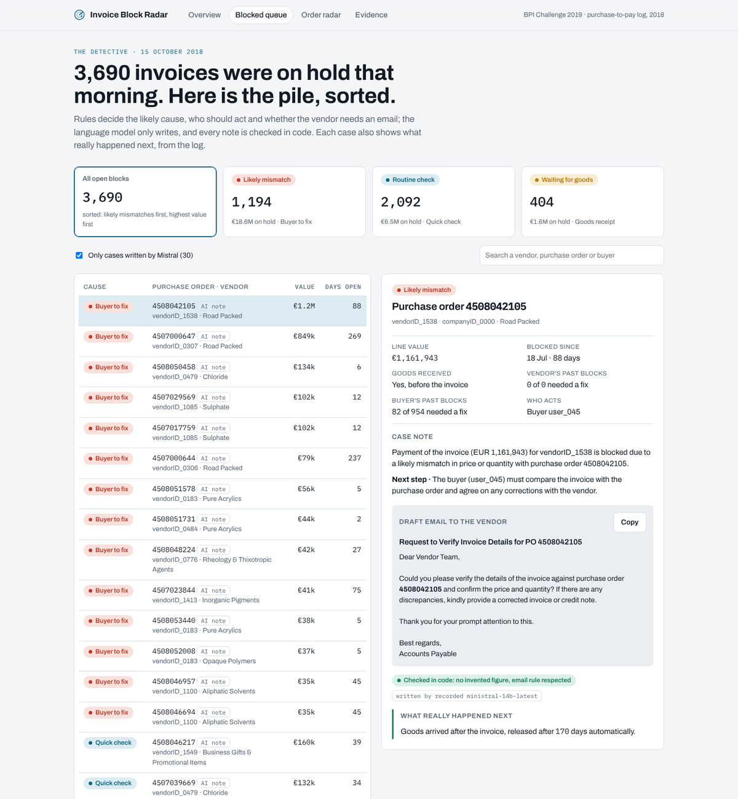
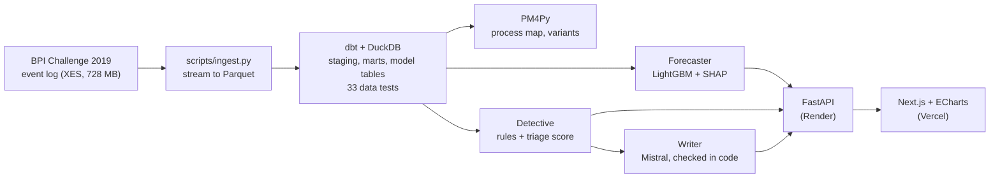
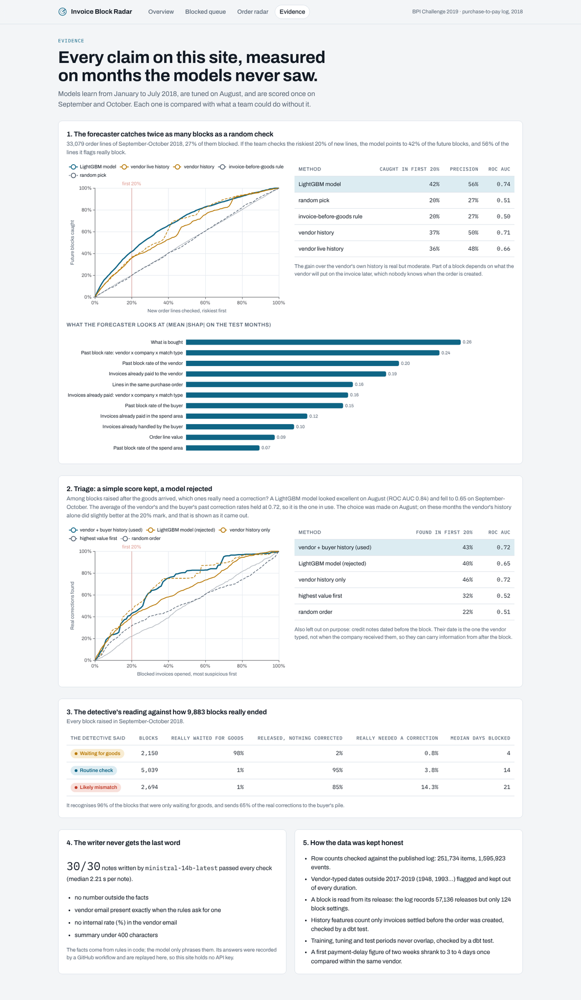

# Invoice Block Radar

Predicts which purchase order lines will hit an invoice payment block, and prepares
the fix for the ones that still do.

Built on a real purchase-to-pay event log: every order line created in 2018 by a
multinational in coatings and paints (BPI Challenge 2019, 251,734 order lines,
1.6 million recorded steps).

**[Live API](https://invoice-block-radar-api.onrender.com/docs)** (the interface goes online next)

> The API runs on a free host that sleeps when idle: the first request after a quiet
> period takes about a minute. The overview and evidence pages do not need it.



## The problem

A company pays a supplier only when three documents agree: the purchase order, the
goods receipt and the invoice (the 3-way match). When they do not, the ERP blocks the
payment, and someone has to investigate, chase the buyer, the warehouse and the
vendor, correct and release it.

What the log shows:

| | |
|---|---|
| Order lines whose payment was blocked | **55,839 of 251,734 (22.2%)** |
| Share of the order value that went through a block | **28.2%** |
| Blocks released by hand | **73%**, by just **10 people** |
| Blocks that ended with **nothing corrected**: a check, then a release | **65%** |
| Extra delay before payment, compared within the same vendor | 3 to 4 days |

Most blocks are false alarms that still cost a person's time. The real problems (an
order or an invoice that had to be corrected) are about 6% of blocks.

For scale, market benchmarks put the cost of handling an invoice at $9.40 on average
against $2.78 for the best teams, with 14% of invoices in exception
([Ardent Partners 2025](https://www.apexanalytix.com/resources/blog/ardent-partners-key-ap-metrics-2025/)).

## What the radar does

Two parts, at two moments.

**1. Before: the forecaster.** When an order line is created, a LightGBM model scores
the risk that its invoice will be blocked, using only what is known at that moment:
what is bought, the vendor, the buyer, the size of the order, and how their earlier,
already-paid invoices went. SHAP says which inputs raised or lowered the risk. A buyer
can confirm the price, quantity or delivery with the vendor before the invoice comes.



**2. After: the detective.** When an invoice blocks anyway, it reads the case and fills
a case file:

- **Rules in code decide the facts**: the likely cause (waiting for goods, likely
  mismatch, routine check), who should act, what to do, the money involved and whether
  the vendor needs an email.
- **A language model only writes**: a two-sentence summary, the next step and, when
  needed, a draft email to the vendor (Mistral `ministral-14b-latest`).
- **Code checks every note** before it is shown: no number that is not in the facts,
  an email exactly when the rules ask for one, no internal rate shown to the vendor.



## Results

Every model learns from January to July 2018, is tuned on August, and is scored once on
September and October, months it never saw. Each is compared with what a team could do
without it. Full figures: [docs/results/](docs/results/) and the
evidence page of the interface.

**Forecaster**, 33,079 order lines of September-October, 27% of them blocked. If the
team checks the riskiest 20% of new lines:

| Method | Future blocks caught | Precision | ROC AUC |
|---|---:|---:|---:|
| **LightGBM model** | **42%** | **56%** | **0.74** |
| Vendor's block rate, Jan-Jul | 37% | 50% | 0.71 |
| Rule on the match type | 20% | 27% | 0.50 |
| Random pick | 20% | 27% | 0.51 |

Twice what a random check finds. The gain over the vendor's own history is real but
moderate: part of a block depends on what the vendor will put on the invoice later,
which nobody knows when the order is created.

**Detective**, every block raised in September-October 2018 (9,883):

| The detective said | Blocks | What really happened |
|---|---:|---|
| Waiting for goods | 2,150 | 98% were only waiting for the goods receipt |
| Routine check | 5,039 | 95% released with nothing corrected |
| Likely mismatch | 2,694 | holds 65% of all the real corrections |

**Writer**: 30 of 30 notes written by Mistral passed every check (about 2 s per note).
They were recorded by a [GitHub workflow](.github/workflows/record-notes.yml) and are
replayed by the demo, which holds no API key.

## Decisions worth knowing

- **A block is read from its release.** The log records 57,136 "Remove Payment Block"
  steps but only 124 "Set Payment Block": the ERP sets blocks on its own. The cause of a
  block is read from what happened between the invoice and the release.
- **A first figure was wrong, and was corrected.** Blocked invoices looked paid two
  weeks later than the others; compared within the same vendor, the gap is 3 to 4 days.
  The rest came from vendors with longer payment terms.
- **A change made before the invoice is not a correction of the block.** Counting it
  inflated "real corrections" from 6% to 14%; the definition was fixed.
- **No look into the future.** History features count only invoices settled before the
  order line was created, and a dbt test recounts them; training, tuning and test
  periods never overlap, also checked by a test. Vendor-typed dates (credit notes,
  invoice dates) are left out of the triage: a note dated before a block may have
  arrived after it.
- **A model was rejected.** For triage, a LightGBM model scored 0.84 ROC AUC on August
  and fell to 0.65 on September-October. A plain score (the vendor's and the buyer's
  past correction rates) held at 0.72 and is the one in use.
- **The first model memorised.** Given the raw vendor and buyer ids, the forecaster
  learned them by heart and stopped after 25 trees. Their dated history replaced them.

## How it is built



| Layer | Tools |
|---|---|
| Ingestion | Python, lxml (streamed), Parquet |
| Warehouse | DuckDB, dbt (staging, marts, model and case tables, a leak-free history macro) |
| Process mining | PM4Py (directly-follows graph, variants) |
| Forecaster | LightGBM, SHAP, scikit-learn |
| Detective | rules in Python, Pydantic, Mistral over HTTPS with a strict JSON schema |
| API | FastAPI, served from small extracts (no event log needed) |
| Interface | Next.js, React, ECharts |
| Quality | 33 dbt data tests, 19 pytest tests, GitHub Actions (Python and web build) |



## Run it locally

```bash
pip install -r requirements.txt

# 1. Data: download BPI_Challenge_2019.xes (see data/README.md) into data/raw/
python scripts/ingest.py data/raw/BPI_Challenge_2019.xes data/parquet
cd warehouse && dbt build --profiles-dir . && cd ..

# 2. Analyses and models (each writes its figures to docs/)
python analysis/process_map.py
python -m radar.forecast
python -m radar.triage
python -m radar.queue
python -m radar.export

# 3. The API and the interface
uvicorn api.main:app --port 8000
cd web && npm install && npm run dev   # http://localhost:3000
```

Steps 1 and 2 are optional: the repository already holds the small extracts the API and
the interface need (`data/demo/`, `models/`, `docs/results/`). With `MISTRAL_API_KEY`
set, a case with no recorded note is written live by Mistral and checked.

## Repository map

```
scripts/ingest.py        XES event log to Parquet
warehouse/               dbt project (DuckDB): models, macros, data tests
analysis/process_map.py  PM4Py process maps and variants
radar/forecast.py        the forecaster (LightGBM + SHAP) and its baselines
radar/triage.py          triage of blocked invoices, the rejected model kept as evidence
radar/detective.py       rules, case file, writers (Mistral, replay, template), checks
radar/queue.py           the detective on Sep-Oct 2018 and the queue of 15 Oct 2018
radar/export.py          small extracts served by the API
api/main.py              FastAPI service
web/                     Next.js interface
docs/results/            every score, as JSON
docs/images/             charts and screenshots
```

## Limits

- One company, one year. The amounts in the log are anonymised by a linear
  transformation, so euro figures show proportions, not real money.
- The log never says why a block was set; causes are read from what happened next.
- "Nothing corrected" means nothing was corrected in the ERP; someone may still have
  phoned the vendor.
- The forecaster is useful as a ranking for checks, not as a decision on its own.

## Data and licence

Data: van Dongen, B.F. (2019), *BPI Challenge 2019*, 4TU.ResearchData,
[DOI 10.4121/uuid:d06aff4b-79f0-45e6-8ec8-e19730c248f1](https://doi.org/10.4121/uuid:d06aff4b-79f0-45e6-8ec8-e19730c248f1).
See [data/README.md](data/README.md). Code under the MIT licence. PM4Py, used for the
process-mining analysis only, is under AGPL-3.0.
