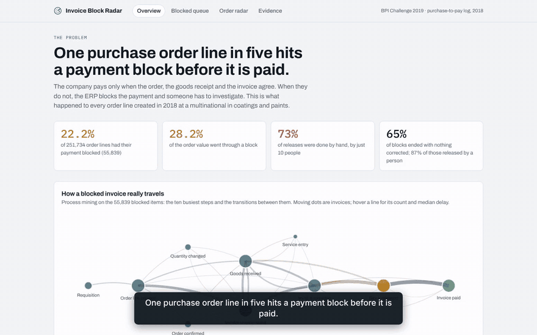
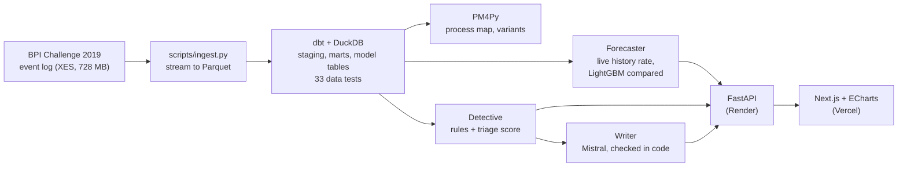

# Invoice Block Radar

Predicts which purchase order lines will hit an invoice payment block, and prepares
the fix for the ones that still do.

Built on a real purchase-to-pay event log: every order line created in 2018 by a
multinational in coatings and paints (BPI Challenge 2019, 251,734 order lines,
1.6 million recorded steps).

**[Open the live demo](https://invoice-block-radar.vercel.app)** ·
[Evidence](https://invoice-block-radar.vercel.app/evidence) ·
[API docs](https://invoice-block-radar-api.onrender.com/docs)

> The API runs on a free host that sleeps when idle: the first request after a quiet
> period takes about a minute. The overview and evidence pages do not need it.



*A one-minute tour ([MP4](docs/media/invoice-block-radar-demo.mp4)), recorded by
[scripts/record_demo.py](scripts/record_demo.py).*

## The problem

A company pays a supplier only when three documents agree: the purchase order, the
goods receipt and the invoice (the 3-way match). When they do not, the ERP blocks the
payment, and someone has to investigate, chase the buyer, the warehouse and the
vendor, correct and release it.

What the log shows:

| | |
|---|---|
| Order lines whose payment was blocked | **55,839 of 251,734 (22.2%)** |
| Share of the order value that went through a block | **28.2%** |
| Blocks released by hand | **73%**, by just **10 people** |
| Blocks that ended with **nothing corrected**: a check, then a release | **65%** |
| Extra delay before payment, compared within the same vendor | 3 to 4 days |


Most blocks are false alarms that still cost a person's time. The real problems (an
order or an invoice that had to be corrected) are about 6% of blocks.

For scale, market benchmarks put the cost of handling an invoice at $9.40 on average
against $2.78 for the best teams, with 14% of invoices in exception
([Ardent Partners 2025](https://www.apexanalytix.com/resources/blog/ardent-partners-key-ap-metrics-2025/)).

## What the radar does

Two parts, at two moments.

**1. Before: the forecaster.** When an order line is created, it gets a risk score: the
block rate of earlier invoices of the same vendor, for the same company and match type,
counting only outcomes that were already known that day. A buyer can confirm the price,
quantity or delivery with the vendor before the invoice comes. Two LightGBM models were
built and compared with this rate month after month; the simple rate won every month
(see [Results](#results)).


**2. After: the detective.** When an invoice blocks anyway, it reads the case and fills
a case file:

- **Rules in code decide the facts**: the likely cause (waiting for goods, likely
  mismatch, routine check), who should act, what to do, the money involved and whether
  a vendor email should be drafted.
- **A language model only writes**: a two-sentence summary, the next step and, for
  likely mismatches, a draft email the buyer sends only if the check confirms a mismatch
  (Mistral `ministral-14b-latest`).
- **Code checks every note** before it is shown: no number outside the facts or written
  in words; in the email, only the order number, value and date, no internal count, rate
  or user id, no accusation, deadline or threat; an email exactly when the rules ask for
  one. Tests try to get past these checks.


## Results

The outcome predicted is "invoice blocked within 60 days of the first invoice", and only
lines invoiced at least 60 days before the log ends are scored, so no outcome is cut
short by the extraction date. Methods are chosen on earlier months, learning only from
outcomes a team would already have known, then scored once on September and October
2018. Every run gives the same numbers. Full figures: [docs/results/](docs/results/) and
the [evidence page](https://invoice-block-radar.vercel.app/evidence).

**Forecaster.** Five candidates were compared on May, June, July and August, each month
learning only from lines whose 60-day window had already closed. The live rate of the
vendor (same company and match type) caught the most blocks every month. Then, on 24,025
order lines of September-October, 24.7% of them blocked, if the team checks the riskiest
20% of new lines:

| Method | Future blocks caught | Precision | ROC AUC |
|---|---:|---:|---:|
| **Vendor x company x match type, live rate (chosen)** | **40%** | **50%** | **0.70** |
| Vendor, live rate | 40% | 50% | 0.70 |
| LightGBM, order facts and history rates | 36% | 44% | 0.67 |
| LightGBM, all inputs | 32% | 40% | 0.67 |
| Buyer, live rate | 31% | 38% | 0.62 |
| Random pick | 20% | 24% | 0.50 |

Twice what a random check finds, with a rule anyone can read.

**Detective**, every block raised in September-October 2018 (9,883). Of the 7,733 blocks
raised after the goods arrived, 7.4% needed a correction and 91% were released with
nothing corrected: those are the rates to beat.

| The detective said | Blocks | Released, nothing corrected | Really needed a correction |
|---|---:|---:|---:|
| Routine check | 5,039 | 95% | 3.8% |
| Likely mismatch | 2,694 | 85% | 14.3% |
| Waiting for goods | 2,150 | 2% (98% only waited for the goods receipt) | 0.8% |

The "likely mismatch" pile is 35% of the blocks raised after the goods arrived and holds
65% of the real corrections, 1.9 times its share. "Waiting for goods" is read from the
missing goods receipt, the very fact it is checked against, so its 98% says little. Most
"likely mismatch" blocks still end with nothing corrected, which is why the vendor email
is a draft for the buyer, not something sent automatically.

**Triage score.** Which blocked invoice to open first: three scores were compared on
August, on the share of real corrections found in the first 20% of the pile. The average
of the vendor's and the buyer's past correction rates won (72%, LightGBM 71%, vendor alone
65%). On September-October it found 43% of the corrections in the first 20% (random: 21%);
the vendor's history alone did a little better there (46%), shown as it came out.

**Writer**: 30 of 30 notes written by Mistral passed every check in code (about 3 s per
note). These checks keep a note inside the facts and the rules; they do not prove the
wording is good. The notes were recorded by a
[GitHub workflow](.github/workflows/record-notes.yml) and are replayed by the demo, which
holds no API key.

## Decisions worth knowing

- **A block is read from its release.** The log records 57,136 "Remove Payment Block"
  steps but only 124 "Set Payment Block": the ERP sets blocks on its own. The cause of a
  block is read from what happened between the invoice and the release.
- **An independent review changed the results, for the better.** A first version of the
  forecaster caught 42% of blocks with a LightGBM model. A review found that its history
  counted some blocks before they were known, that it learned from recent lines whose
  outcome was not known yet, that blocks still open at the end of the log were counted
  as "not blocked", and that runs were not exactly reproducible. With all four fixed, the
  machine-learning models fell behind a plain history rate, so the plain rate is used.
- **A first delay figure was wrong.** Blocked invoices looked paid two weeks later than
  the others; compared within the same vendor the gap is 3 to 4 days
  ([overview.json](data/demo/overview.json), `payment_delay`). The rest came from vendors
  with longer payment terms.
- **A change made before the invoice is not a correction of the block.** Counting it
  inflated "real corrections" from 6% to 14%; the definition was fixed.
- **No look into the future.** History features count an outcome only from the moment it
  was known, and a dbt test recounts them; training, tuning and test periods never
  overlap, also checked by a test. Vendor-typed dates (credit notes, invoice dates) are
  left out of the triage: a note dated before a block may have arrived after it.

## How it is built



| Layer | Tools |
|---|---|
| Ingestion | Python, lxml (streamed), Parquet |
| Warehouse | DuckDB, dbt (staging, marts, model and case tables, a leak-free history macro) |
| Process mining | PM4Py (directly-follows graph, variants) |
| Forecaster | rolling month-by-month comparison: live history rates against LightGBM models, scikit-learn metrics |
| Detective | rules in Python, Pydantic, Mistral over HTTPS with a strict JSON schema |
| API | FastAPI, served from small extracts (no event log needed) |
| Interface | Next.js, React, ECharts |
| Quality | 33 dbt data tests (run locally on the full log), 27 pytest tests and the web build in GitHub Actions |


## Run it locally

```bash
pip install -r requirements.txt

# 1. Data: download BPI_Challenge_2019.xes (see data/README.md) into data/raw/
python scripts/ingest.py data/raw/BPI_Challenge_2019.xes data/parquet
cd warehouse && dbt build --profiles-dir . && cd ..

# 2. Analyses and models (each writes its figures to docs/)
python analysis/process_map.py
python -m radar.forecast
python -m radar.triage
python -m radar.queue
python -m radar.export

# 3. The API and the interface
uvicorn api.main:app --port 8000
cd web && npm install && npm run dev   # http://localhost:3000
```

Steps 1 and 2 are optional: the repository already holds the small extracts the API and
the interface need (`data/demo/`, `models/`, `docs/results/`). With `MISTRAL_API_KEY`
set, a case with no recorded note is written live by Mistral and checked.

## Repository map

```
scripts/ingest.py        XES event log to Parquet
warehouse/               dbt project (DuckDB): models, macros, data tests
analysis/process_map.py  PM4Py process maps and variants
radar/forecast.py        the forecaster: candidates, rolling check, single test
radar/triage.py          triage of blocked invoices, the rejected model kept as evidence
radar/detective.py       rules, case file, writers (Mistral, replay, template), checks
radar/queue.py           the detective on Sep-Oct 2018 and the queue of 15 Oct 2018
radar/export.py          small extracts served by the API
scripts/record_demo.py   the captioned demo video (Playwright + ffmpeg)
api/main.py              FastAPI service
web/                     Next.js interface
docs/results/            every score, as JSON
docs/images/             charts and screenshots
```

## Limits

- One company, one year. The amounts in the log are anonymised by a linear
  transformation, so euro figures show proportions, not real money.
- The log never says why a block was set; causes are read from what happened next.
- "Nothing corrected" means nothing was corrected in the ERP; someone may still have
  phoned the vendor. 13% of those blocks were released by a batch job, not a person.
- The 22% headline counts every order line of the log; the models score invoiced lines
  only ("once this line is invoiced, will the invoice block?"), 25% of which blocked.
- Blocks still open when the log ends are not in the detective's figures.
- The scores are useful as a ranking for checks, not as a decision on their own.

## Data and licence

Data: van Dongen, B.F. (2019), *BPI Challenge 2019*, 4TU.ResearchData,
[DOI 10.4121/uuid:d06aff4b-79f0-45e6-8ec8-e19730c248f1](https://doi.org/10.4121/uuid:d06aff4b-79f0-45e6-8ec8-e19730c248f1).
See [data/README.md](data/README.md). Code under the MIT licence. PM4Py, used for the
process-mining analysis only, is under AGPL-3.0.
